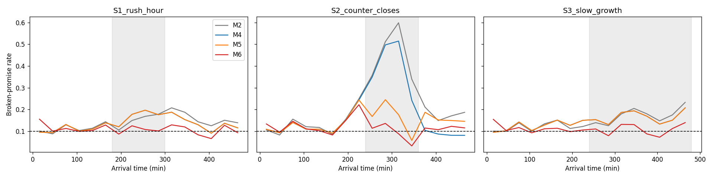

# Reliable Waiting-Time Announcements Under Changing Queue Conditions
*A simulation study (pilot) by Sharmeen Mahmood*

## Problem
Service points often tell customers "your wait is about X minutes". When conditions change
suddenly (a rush, a counter closing), these announcements break. This project measures how often
a customer waits longer than announced ("broken promise") and tests ways to keep that rate near 10%.

## Related work
- Delay announcements and customer reactions (balking) in queueing theory: Whitt (1999); Armony, Shimkin and Whitt (2009).
- Adaptive and conformal prediction intervals under distribution shift: Gibbs and Candes (2021); an ICU length-of-stay application by Dronavajjala (MLHC 2026).
- Literature searches are logged in `search_log.md`. No direct match for adaptive announcement margins under sudden capacity changes was found in our searches.

## Method
- Queue simulator (one line, first come first served, 3 counters), checked against the Erlang C formula: 6.54 vs 6.47 minutes.
- Four scenarios: normal day, rush hour, counter closes, slow growth.
- A predictor learned from normal days only: wait = 1.93 + 2.02 x people ahead.
- Six announcement methods:

| Method | Idea |
|---|---|
| M1 | prediction only |
| M2 | prediction + fixed margin |
| M3 | margin recalculated every 50 customers |
| M4 | adaptive margin (grows when wrong, shrinks slowly when right) |
| M5 | M4 + event-aware correction when counters close |
| M6 | M5 + margin that grows with line length |

- Realistic feedback: margins learn only from customers whose service has already started.
- Settings were chosen on separate tuning days. Results use 100 separate test days per scenario, with 95% confidence intervals.

## Results
Broken-promise rate (%), target = 10%:

| Scenario | M1 | M2 | M3 | M4 | M5 | M6 |
|---|---|---|---|---|---|---|
| Normal | 41.9 | 11.0 | 12.8 | 11.6 | 11.6 | 10.9 |
| Rush hour | 44.1 | 13.2 | 14.6 | 13.4 | 13.4 | 10.3 |
| Counter closes | 52.3 | 23.4 | 21.9 | 19.5 | 14.3 | 11.0 |
| Slow growth | 44.4 | 14.3 | 15.7 | 14.5 | 14.5 | 10.5 |

Reliability by line length (all scenarios together):

| Method | 1-2 ahead | 3-5 ahead | 6+ ahead |
|---|---|---|---|
| M2 | 9.3% | 15.8% | 27.0% |
| M4 | 11.4% | 17.5% | 21.0% |
| M5 | 11.2% | 16.3% | 18.1% |
| M6 | 11.8% | 11.3% | 9.3% |

Ablation in the counter-closure scenario: M4 19.5%, M4 with scaled margin only 17.2%, M5 14.3%, M6 11.0%,
M4 with faster learning 18.5%, M5 with faster learning 14.8%.

Key findings:
1. A plain prediction breaks promises 42-52% of the time, so a margin is necessary.
2. A counter closing is the hardest shift. During it, M2, M3 and M4 break 38-44% of promises; the event-aware correction (M5) reduces this to 15.3%.
3. M6 stays near 10% in all four scenarios (10.3-11.0%), and for customers with 6 or more people ahead it reaches 9.3% (M5: 18.1%).
4. Ablation: both the correction and the length scaling help. Faster learning after an event does not.
5. Robustness: when recalibrated on each system's own normal days, M6 stays at 9-11% for service-time variability CV = 0.5, 1.0 and 1.5.
6. Balking test (customers leave after long announcements): M6 keeps broken promises near 11% in the counter-closure scenario, versus 16.4% for M4.

## Failure cases
- Customers arriving just before a surprise closure still break about 22% of promises, because nobody could know.
- In the first 30 minutes of a day, M6 starts above target because its starting margin has not adapted yet.
- With other service patterns, the line-length flattening is not perfect.

## Limitations
- All data is simulated, including the rule for customers who leave.
- The square-root scaling comes from queueing theory and fits this simulator well by design.
- The correction for closed counters is hand-written domain knowledge. A model trained with "open counters" as an input would not need it.
- One queue type and one predictor. No real-world data and no user study.

## Future work
Test on real queue data; run a short survey on which announcement wording people prefer; learn the scaling from data instead of writing it by hand.

## How to reproduce
Open `queue_announcement_reliability_v2.ipynb` in Google Colab and run all cells in order. Seeds are fixed, so the tables match exactly.

- `queue_announcement_reliability_v2.ipynb`: all code
- `results/`: tables (CSV) and figures
- `search_log.md`: literature searches
